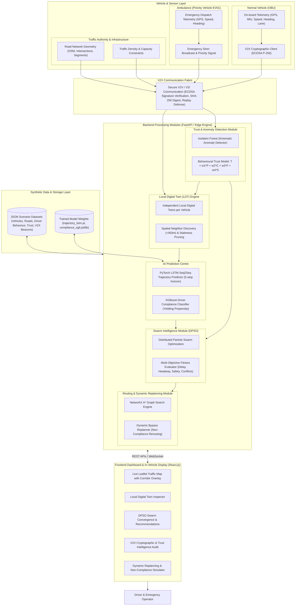
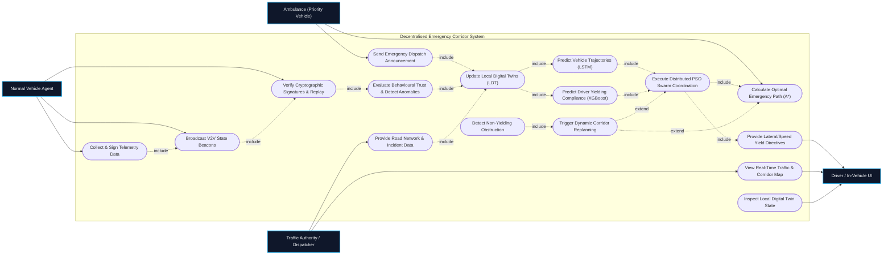
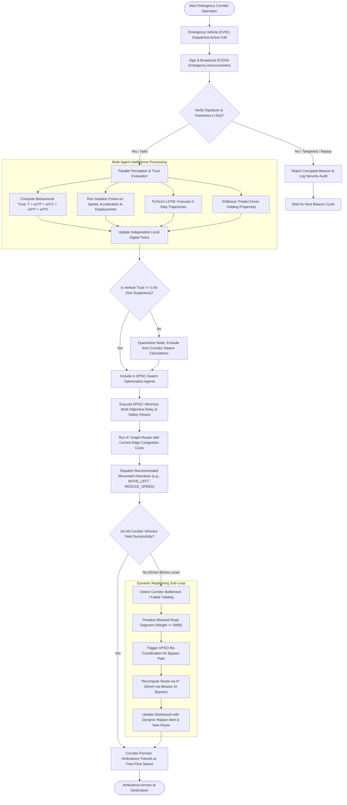

# Trust- and Compliance-Aware Decentralised Emergency Vehicle Corridor Coordination Using Local Digital Twins and Swarm Intelligence

## Comprehensive System Architecture & UML Design Specification Document
*(Derived & Enhanced from `Traffic_review2.pptx`)*

**Project Team Members:**
- V Krishna Teja (23P61A66H6)
- V Manasa (23P61A66H9)
- S Sri Ram (23P61A66F4)

**Internal Guide:**
- Mrs. T. Adarana (Assistant Professor, Dept. of Computer Science & Engineering)

---

## Executive Summary

This specification document formalizes the software design, system architecture, and UML modeling for the **Trust- and Compliance-Aware Decentralised Emergency Vehicle Corridor Coordination Framework**.

Deriving foundational concepts from the review presentation **`Traffic_review2.pptx` (SwarmTwin)**, this implementation elevates the architecture into a fully autonomous, algorithm-driven application using **FastAPI**, **React.js**, and **synthetic JSON traffic telemetry**. It eliminates external traffic simulators (SUMO/TraCI/CARLA) and provides a pure software-driven decentralised coordination platform incorporating:
1. **ECDSA (NIST P-256) Digital Signatures & Replay Prevention**
2. **Independent Local Digital Twins (LDT)** on every vehicle agent
3. **Behavioural Trust Scoring & Isolation Forest Anomaly Detection**
4. **PyTorch LSTM Multi-Step Trajectory Prediction**
5. **XGBoost Driver Yielding Compliance Inference**
6. **Distributed Particle Swarm Optimization (DPSO)** for cooperative corridor establishment
7. **NetworkX A\* Graph Search with Real-Time Dynamic Replanning**

---

## 1. System Architecture Diagram
*(Referenced from Slide 8: System Architecture)*

### Diagram


### Architectural Description
1. **On-Board Units (OBU) & Sensor Layer**: Captures vehicle kinematics (speed, acceleration, heading, lane position). The ambulance (EV01) broadcasts priority dispatch intents.
2. **Secure V2X Fabric**: Applies ECDSA (SECP256R1) signing and SHA-256 hashing. Enforces timestamp validity ($|t_{now} - t_{msg}| \le 15$s) and monotonic sequence number checks to defeat replay attacks.
3. **Local Digital Twin (LDT) Engine**: Each vehicle agent maintains an isolated digital twin instance representing its local spatio-temporal neighborhood ($<450$m), incorporating trust-attenuated neighbor states.
4. **Trust & Anomaly Detection**:
   - **Isolation Forest**: Evaluates kinematics and flags sudden teleportations, impossible accelerations, and beacon flood anomalies.
   - **Behavioural Trust Model**: Evaluates $T(i) = 0.35P + 0.25C + 0.20F + 0.20S$ ($P$: position plausibility, $C$: movement consistency, $F$: message freshness, $S$: sensor consistency).
5. **AI Prediction Centre**:
   - **PyTorch LSTM**: Seq2Seq model forecasting 5 future timesteps ($t+1$ to $t+5$ seconds ahead) with uncertainty bounds.
   - **XGBoost Classifier**: Multi-class model predicting yielding probability ($0.0 - 1.0$) and compliance category (`High`, `Medium`, `Low`).
6. **Distributed PSO Swarm Optimization**: Multi-objective fitness function minimizing emergency delay, safety headway violations, normal traffic disruption, and trajectory conflicts. Dispatches actions: `MOVE_LEFT`, `MOVE_RIGHT`, `REDUCE_SPEED`, `MAINTAIN_GAP`, `MAINTAIN_POSITION`.
7. **A\* Route Planning & Dynamic Replanning**: NetworkX road graph with dynamic edge costs. If a vehicle fails to yield, edge blockage penalty ($+9999$) is triggered and the emergency route dynamically reroutes via the Mission Bypass.

---

## 2. Use Case Diagram
*(Referenced from Slide 11: Use Case Diagram)*

### Diagram


### Actors and Use Case Details
- **Normal Vehicle Agent**: Collects kinematic telemetry, signs V2V beacons via ECDSA, detects neighbors, and verifies incoming packets.
- **Ambulance (Priority Vehicle)**: Broadcasts priority dispatch signal, specifies target corridor lane (Lane 2 Center), and queries optimal clearance path.
- **Driver / In-Vehicle UI**: Receives lane yielding recommendations (`MOVE_LEFT`, `MOVE_RIGHT`, `REDUCE_SPEED`), views the live traffic map, and inspects the Local Digital Twin.
- **Traffic Authority**: Updates road network geometry, lane capacities, and static congestion thresholds.

---

## 3. Sequence Diagram
*(Referenced from Slide 12: Sequence Diagram)*

### Diagram
```mermaid
sequenceDiagram
    autonumber
    actor Driver as Driver / EV Operator
    participant Vehicle as Ego Vehicle
    participant Sensors as On-board Sensors
    participant V2X as V2X Crypto & Comm
    participant Nearby as Nearby Vehicles
    participant LDT as Local Digital Twin
    participant AI as AI Predictors (LSTM/XGB)
    participant Swarm as Swarm Engine (DPSO)
    participant Router as A* Navigation Router
    participant Dashboard as React Dashboard

    Driver->>Vehicle: Initiate dispatch / Drive
    Vehicle->>Sensors: Request telemetry (GPS, speed, lane, heading)
    Sensors-->>Vehicle: Return raw telemetry
    Vehicle->>V2X: Generate beacon + Sign with ECDSA (P-256)
    V2X->>Nearby: Broadcast signed beacon / Emergency announcement
    Nearby-->>V2X: Receive neighboring vehicle beacons
    V2X->>V2X: Verify ECDSA signatures, check freshness & sequence replay

    V2X->>LDT: Integrate authenticated telemetry into Local Twin
    LDT->>LDT: Discover neighbors (<450m) & calculate relative headways
    LDT->>AI: Query future states (History -> LSTM; Behaviour -> XGBoost)
    AI-->>LDT: Return 5-step predicted trajectory + Yielding probability

    LDT->>Swarm: Provide ego & neighbor twins, trust weights & compliance
    Swarm->>Swarm: Run DPSO particles (optimize lateral movements & headway)
    Swarm->>Swarm: Check safety constraints & resolve movement conflicts
    Swarm-->>Router: Pass clearance readiness of primary corridor lanes

    Router->>Router: Execute A* search with congestion & blockage penalties
    alt Vehicle yields as expected
        Router-->>Dashboard: Return optimal Market St Corridor (INT_1 -> INT_5)
    else Driver fails to yield (Obstruction detected)
        Swarm->>Router: Report non-yielding blockage on segment
        Router->>Router: Dynamically re-weight edge & replan via Mission Bypass
        Router-->>Dashboard: Return updated dynamic replanned route
    end

    Swarm-->>Vehicle: Dispatched recommended actions (MOVE_LEFT, REDUCE_SPEED)
    Vehicle-->>Driver: Display lane yield prompt & headway warning
    Dashboard-->>Driver: Render live corridor map, twin telemetry & alerts
```

### Execution Trace
1. **Sensory Polling**: Onboard sensors register speed, lane, heading, and distance to emergency vehicles.
2. **Cryptographic Transmission**: Packets are authenticated with ECDSA signatures and SHA-256 digests.
3. **Local World Integration**: Local Digital Twins assimilate authenticated neighbors within radio range ($<450$m).
4. **Machine Learning Inference**: Concurrently queries PyTorch LSTM for future positions and XGBoost for yielding compliance.
5. **Swarm Convergence**: DPSO evaluates candidate action vectors across all participating agents to minimize delay and maximize safety headway.
6. **Dynamic Replanning**: If an obstruction is detected (e.g., V004 refuses to yield), the system triggers dynamic A\* replanning in real time.

---

## 4. Activity Diagram
*(Synthesizing Operational Control Flow & Replanning Branching)*

### Diagram


---

## 5. Generated Documentation Artifacts

1. **Word Document (`.docx`)**:
   - Location: [`Emergency_Vehicle_Corridor_Coordination_Design_Document.docx`](file:///c:/Users/rishi/Downloads/Krishna%20Teja/Emergency_Vehicle_Corridor_Coordination_Design_Document.docx)
   - Size: ~2.85 MB
   - Features: Formatted typography, author metadata, executive summary, callout cards, step-by-step numbered breakdowns, and **embedded high-resolution images** for all diagrams (System Architecture, Use Case, Sequence, Activity, and Class Diagrams).
2. **Markdown Specification**:
   - Location: [`ARCHITECTURE_AND_DESIGN_DOCUMENT.md`](file:///c:/Users/rishi/Downloads/Krishna%20Teja/ARCHITECTURE_AND_DESIGN_DOCUMENT.md)
   - Features: Full Mermaid diagram code blocks ready for GitHub rendering.

